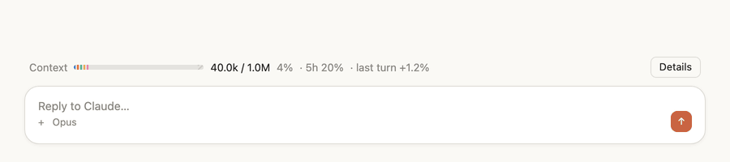

# Claude Context Meter

**See your context window and your usage limits while you work, and get a specific warning before a session burns through them.**

A [Claude Code](https://code.claude.com) plugin for the desktop app, the terminal, VS Code and mobile.

<picture>
  <source media="(prefers-color-scheme: dark)" srcset="docs/demo-dark.gif">
  
</picture>

## Why

Every turn re-sends the whole conversation. At 150k tokens of context, a one-line question costs as much as a long task did at the start of the session. The desktop app no longer shows a context meter, so the first sign of trouble is often hitting the 5-hour limit.

This plugin shows what each turn costs and tells you why:

| You see | It means | Suggested fix |
| --- | --- | --- |
| `Each turn re-reads 150k` | The context is large | Save & compact, or `/clear` before a new task |
| `Last turn used 3.0% of 5h on a small context` | The model or the ask is heavy, not the context | Sonnet, lower effort, or a narrower ask |
| `MCP tools hold 25k (notion 25k)` | Tool schemas are taking up the window | Disable servers you are not using |
| `At this pace the 5h limit runs out at 14:20` | You will run out before your target hours | Slow down, or move bulk work to cheaper models |
| `Today used 21% of the weekly limit` | Over your daily share of the week | Keep the rest of the day light |

## Features

- **Meter above the prompt.** Shows tokens used out of the window in a stacked bar: Messages, System, MCP, Memory & skills, Other, free space, and the hatched autocompact buffer. Hover a segment for its exact figure. The same line shows the 5-hour usage and what the last turn cost.
- **Per-turn cost.** The plugin reads the account's 5-hour utilization when a turn starts and when it ends, and shows the difference. It flags turns above your threshold (default 2%).
- **Pace projection.** Projects when the 5-hour window runs out at the current pace and warns if that is sooner than your target (default 4 hours).
- **Daily weekly budget.** Tracks how much of the 7-day limit you have used today, against a daily share (default 20%).
- **Detail pane.** Click **Details** or run `/context-meter` to see the full breakdown, the largest MCP servers, deferred tools, the limit figures and every current tip.
- **Save & compact.** One click asks Claude to write facts, progress, plan and decisions to the project's notes file (or a `HANDOFF.md`), then compacts once that turn ends.
- **Light and dark mode** in every surface. The palette is checked for color-blind safety.

<picture>
  <source media="(prefers-color-scheme: dark)" srcset="docs/pane-dark.png">
  
</picture>

## Install

In a Claude Code terminal session, run:

```
/plugin install context-meter --marketplace saeed1507100/claude-context-meter
```

Answer `y` to add the marketplace, then choose the **user** scope so the plugin runs in every session, including the desktop app. Restart open sessions, or run `/reload-plugins`.

To update later:

```
claude plugin update context-meter
```

## Settings

Change them in `/config` under **context-meter**:

| Option | Default | What it does |
| --- | --- | --- |
| `targetHours` | 4 | Warn when the pace would use up the 5-hour window sooner than this |
| `turnAlertPercent` | 2 | Flag a turn that uses more than this share of the 5-hour window |
| `dailyWeeklyPercent` | 20 | Warn when today has used more than this share of the weekly limit |

These defaults are meant for about 4 hours of work in every 5-hour window, and five working days a week.

## Privacy and security

- **No telemetry. Your data stays on your machine.** The plugin makes one network request: it reads your own usage from `api.anthropic.com/api/oauth/usage`. It does this once a minute and at the start and end of each turn.
- **The plugin never sees your token.** The request goes through Claude Code's credential handle (`$.session.authorize()`).
- With an API key, a third-party provider or no network, the request fails. The plugin then uses the figures from the session's last reply and labels them "as of last reply".
- The plugin keeps one value across sessions, in its own plugin store: today's starting weekly percentage.
- The usage endpoint is not a documented public API, so it may change. If it does, the meter falls back to the figures from the last reply.

## Limits

- The 5-hour and weekly figures are account-wide. A turn that runs while another session is active also counts that session's usage.
- The usage endpoint reports whole-window percentages, so a very small turn can show as +0.0%.
- The context breakdown is estimated locally (`breakdown: 'summary'`), so it sends no extra token-count requests. It can differ slightly from `/context`.

## Develop

```bash
claude plugin validate .
claude plugin test .
npx -p typescript tsc -p . --noEmit
claude --plugin-dir .
```

Regenerate the demo GIFs and pane screenshots in `docs/` with `docs/demo/run.sh` (needs ffmpeg and Playwright chromium).

## License

[MIT](LICENSE)
